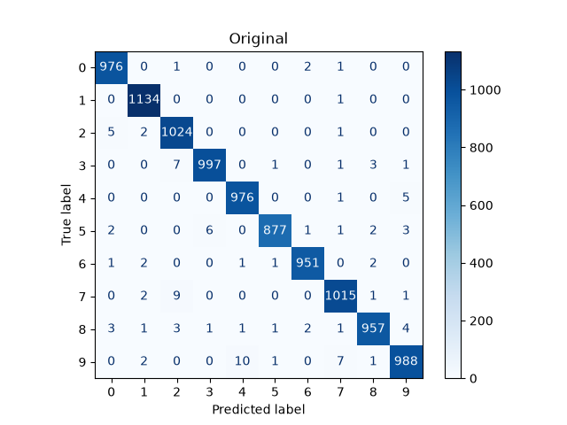
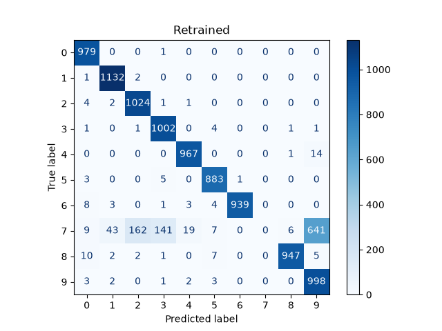
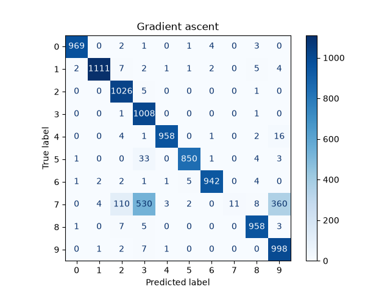
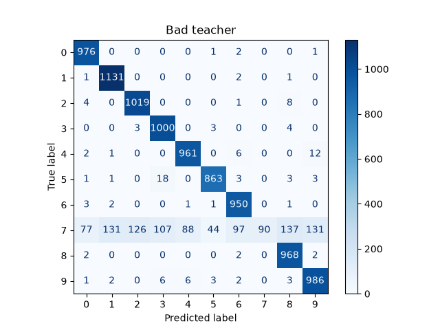
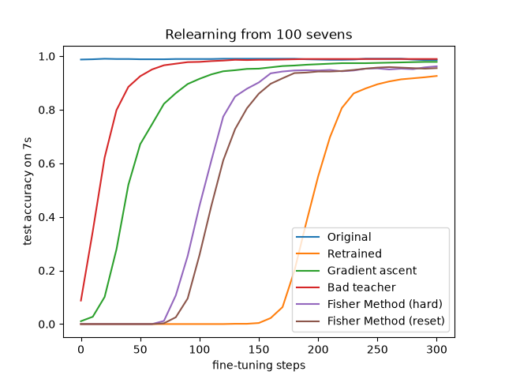

# Machine Unlearning on MNIST: Output vs. Latent Space Audits

An empirical study and PyTorch implementation of **Class-Level Machine Unlearning** on MNIST (forgetting digit `7`). 

This project demonstrates why **output-space metrics are insufficient** for unlearning tasks. We see that common baseline methods like **Gradient Ascent** and **Bad Teacher Distillation** merely scramble the final classification head (`fc2`) while leaving internal feature representations (`conv2`, `fc1`) intact. 

To achieve structural unlearning, we implement **Fisher Information Pruning** (including an ablation comparing **Hard Pruning** vs. **Synaptic Reset**) and audit all models across three distinct regimes:
1. **Output Space (`evaluate.py`):** Retain/Forget Accuracy, Jensen-Shannon (JS) Divergence against a Retrained-from-Scratch oracle, and Confusion Matrices.
2. **Latent Representation Space (`probe.py`):** Linear probing on frozen penultimate (`fc1`) activations to detect residual feature separability.
3. **Weight Plasticity / Sample Complexity (`relearn.py`):** Few-shot relearning speed (100 samples of digit `7`) to test whether features are truly erased or merely unlinked.

---

## 1. Architecture & Dataset Split

We use a 4-layer Convolutional Neural Network (`model.py`, **206,922 trainable parameters**):
* `conv1`: $\text{Conv2d}(1 \to 16, 3\times 3, \text{pad}=1) \to \text{ReLU} \to \text{MaxPool2d}(2)$
* `conv2`: $\text{Conv2d}(16 \to 32, 3\times 3, \text{pad}=1) \to \text{ReLU} \to \text{MaxPool2d}(2)$
* `fc1`: $\text{Linear}(32 \times 7 \times 7 \to 128) \to \text{ReLU}$ *(128-dim latent feature representation)*
* `fc2`: $\text{Linear}(128 \to 10)$ *(classification logits)*

**MNIST Class-Split (`data.py`, target forget digit = `7`):**
* **Train Set:** `53,735` Retain images ($\mathcal{D}_r$, digits `0–6, 8, 9`) | `6,265` Forget images ($\mathcal{D}_f$, digit `7`)
* **Test Set:** `8,972` Retain images | `1,028` Forget images

---

## 2. Unlearning Methodologies (`unlearn.py`)

We benchmark four unlearning configurations against the **Original Model** (trained on all 10 digits) and the **Retrained Oracle** (trained from scratch exclusively on $\mathcal{D}_r$):

### A. Gradient Ascent (`grad_asc`)
Maximizes Cross-Entropy loss on $\mathcal{D}_f$ ($\mathcal{L} = -\text{CE}(f_\theta(x_f), y_f)$) while alternating with standard gradient descent steps on $\mathcal{D}_r$ using separate Adam optimizers (`lr=1e-4`) to prevent catastrophic forgetting. Uses batch-level early stopping (`stop_acc=0.01`, triggered at batch 72) to halt destructive updates before retain utility collapses.

### B. Bad Teacher Distillation (`bad_teacher`)
Following *Chundawat et al. (AAAI 2023)*, a student model (initialized from the original weights) is trained simultaneously via KL-Divergence against two teachers:
* **On $\mathcal{D}_r$ (Good Teacher):** Minimizes $D_{\text{KL}}(P_{\text{good}}(x_r) \parallel P_{\text{student}}(x_r))$ against a frozen copy of the original model to preserve retain-class boundaries.
* **On $\mathcal{D}_f$ (Dumb Teacher):** Minimizes $D_{\text{KL}}(P_{\text{dumb}}(x_f) \parallel P_{\text{student}}(x_f))$ against a randomly initialized, untrained `CNN()` to force uninformative predictions on digit `7`.

### C. Fisher Information Pruning (`fisher_prune`)
Expanding the dataset loss $\mathcal{L}(w + \Delta w)$ via a second-order Taylor series around a converged local minimum ($\nabla_w \mathcal{L} \approx 0$) and applying a diagonal Hessian approximation (*LeCun et al., 1990*) yields:

$$\Delta \mathcal{L} \approx \frac{1}{2} \sum_i H_{ii} (\Delta w_i)^2$$

Rather than computing second derivatives directly, we estimate the **empirical Fisher Information diagonal** via the expectation of squared first-order gradients across mini-batches:

$$F_{ii}(\mathcal{D}) = \frac{1}{\vert{}\mathcal{B}\vert{}} \sum_{b \in \mathcal{B}} \left( \frac{\partial \mathcal{L}_b}{\partial w_i} \right)^2$$

Both $\mathcal{D}_f$ and $\mathcal{D}_r$ are evaluated using matched subset sizes of $6,265$ samples and batch size $64$ so that mini-batch gradient variance scaling cancels cleanly in their ratio. For every parameter in the mid-to-high-level feature layers (`conv2` and `fc1`, leaving early edge detectors in `conv1` untouched), we compute the relative forget-to-retain specialization score (*Foster et al., 2024; Pochinkov & Schoots, 2024*):

$$S_i = \frac{F_{ii}(\mathcal{D}_f)}{F_{ii}(\mathcal{D}_r) + 10^{-8}}$$

We prune the top **35%** (`prune_ratio=0.35`) most `7`-specialized weights (`1,613/4,608` in `conv2.weight` and `70,247/200,704` in `fc1.weight`) by setting them to `0.0`, reset the output head slice `fc2[7] = 0.0`, and heal on $\mathcal{D}_r$ for 2 epochs (`lr=1e-3`). We evaluate two healing regimes:
1. **Fisher Method (Hard Pruning, `lock_mask=True`):** Gradients of pruned weights are zeroed out on every healing step (`p.grad[mask] = 0.0`), permanently locking the 35% excised synapses at `0.0`.
2. **Fisher Method (Synaptic Reset, `lock_mask=False`):** After zeroing out the top 35% `7`-specialized weights, the zeroed synapses are left unlocked during retain-set healing so gradient descent can repurpose that capacity for $\mathcal{D}_r$.

---

## 3. Experimental Results

### Master Comparison Table

| Model / Method | Test Retain Acc ($\uparrow$) | Test Forget Acc ($\downarrow$) | JS Div Retain ($\downarrow$) | JS Div Forget ($\downarrow$) | Linear Probe Bal. Acc ($\to 0.9862$) | Linear Probe AUC ($\to 0.9986$) | Relearn Steps to 90% ($\to 260$) | Relearn Final Acc @ 300 Steps |
| :--- | :---: | :---: | :---: | :---: | :---: | :---: | :---: | :---: |
| **Original Model** | `0.9897` | `0.9874` | `0.0062` | `0.6745` | `0.9957` | `0.9999` | `0` | `0.9854` |
| **Retrained (Gold Standard)** | **`0.9887`** | **`0.0000`** | **`0.0000`** | **`0.0000`** | **`0.9862`** | **`0.9986`** | **`260`** | **`0.9261`** |
| **Gradient Ascent** | `0.9831` | `0.0107` | `0.0097` | `0.2151` | `0.9960` | `0.9999` | `100` | `0.9786` |
| **Bad Teacher** | `0.9868` | `0.0875` | `0.0282` | `0.3841` | `0.9943` | `0.9999` | `50` | `0.9893` |
| **Fisher Method (Hard)** | `0.9766` | **`0.0000`** | `0.0161` | **`0.0911`** | `0.9769` | `0.9971` | `150` | `0.9621` |
| **Fisher Method (Reset)** | `0.9815` | **`0.0000`** | **`0.0095`** | `0.1000` | **`0.9865`** | **`0.9991`** | **`170`** | **`0.9553`** |

---

## 4. Analysis

### 4.1 Output-Space Behaviour & Prediction Distributions (`evaluate.py`)
A model that never saw `7`s (**Retrained**) does not output a uniform random distribution across 0–9 when shown a `7`; instead, it maps `7`s onto visually similar digits that share top horizontal bars and diagonal stems—primarily **`9` (62.4%)**, **`2` (15.8%)**, and **`3` (13.7%)**[cite: 3].

| Model | Class `0` | Class `1` | Class `2` | Class `3` | Class `4` | Class `5` | Class `6` | **Class `7` (Target)** | Class `8` | Class `9` |
| :--- | :---: | :---: | :---: | :---: | :---: | :---: | :---: | :---: | :---: | :---: |
| **Original** | 0.0% | 0.2% | 0.9% | 0.0% | 0.0% | 0.0% | 0.0% | **98.7%** | 0.1% | 0.1% |
| **Retrained (Ideal)** | 0.9% | 4.2% | **15.8%** | **13.7%** | 1.8% | 0.7% | 0.0% | **0.0%** | 0.6% | **62.4%** |
| **Gradient Ascent** | 0.0% | 0.4% | 10.7% | **51.6%** | 0.3% | 0.2% | 0.0% | **1.1%** | 0.8% | **35.0%** |
| **Bad Teacher** | 7.5% | 12.7% | 12.3% | 10.4% | 8.6% | 4.3% | 9.4% | **8.8%** | 13.3% | 12.7% |
| **Fisher (Hard)** | 0.0% | 3.5% | **13.7%** | **10.2%** | 1.1% | 0.0% | 0.0% | **0.0%** | 1.2% | **70.3%** |
| **Fisher (Reset)** | 0.0% | 1.8% | **7.5%** | **32.0%** | 1.4% | 0.0% | 0.0% | **0.0%** | 1.2% | **56.2%** |

* **Why Bad Teacher Fails JS Divergence (`0.3841`):** Because the dumb teacher is randomly initialized, distilling its outputs on $\mathcal{D}_f$ forces the student to scatter `7`s nearly uniformly across all 10 classes (`4.3%–13.3%`), leaving `8.8%` accuracy on class `7` itself[cite: 8]. This unnatural uniform scattering is heavily penalized by JS Divergence against the Retrained oracle.
* **Why Fisher Pruning Matches the Oracle (`0.0911` / `0.1000`):** By excising `7`-specific detectors and healing on $\mathcal{D}_r$, both Fisher models naturally map `7`s onto the exact same geometric neighbors (`9`, `3`, and `2`) as the Retrained model, achieving a **~4x lower JS divergence** than Bad Teacher and **>2x lower** than Gradient Ascent.

#### Confusion Matrices across Models
| Original Model | Retrained (Gold Standard) |
| :---: | :---: |
|  |  |
| **Gradient Ascent** | **Bad Teacher** |
|  |  |
| **Fisher Method (Hard Pruning)** | **Fisher Method (Synaptic Reset)** |
| .png>) | .png>) |

---

### 4.2 Latent Feature Audit via Linear Probing (`probe.py`)
We freeze each model's feature extractor (`conv1` $\to$ `conv2` $\to$ `fc1`), extract the 128-dimensional embeddings for all 60,000 training and 10,000 test images, and train a class-balanced `LogisticRegression` binary probe (`digit == 7` vs. `digit != 7`).

1. **Why the Retrained Oracle achieves `0.9862` (not `0.50`):** Even without ever seeing a `7`, a CNN trained on digits `0–6, 8, 9` learns general stroke primitives (horizontal top bars for `5`, diagonal lines for `1` and `4`). When a `7` is passed through those general filters, it produces a consistent combinatorial activation pattern that a newly trained linear classifier can separate at `0.9862` balanced accuracy. **The goal of unlearning is not to destroy the network's general vision primitives, but to match this `0.9862` baseline by removing dedicated `7`-detectors.**
2. **Gradient Ascent (`0.9960`) & Bad Teacher (`0.9943`) Fail the Latent Audit:** Both methods exhibit virtually zero drop in linear probe accuracy compared to the Original model (`0.9957`). Their optimization updates modified the final linear layer `fc2` while leaving the `7`-specialized features in `conv2` and `fc1` untouched.
3. **Hard Pruning (`0.9769`) vs. Synaptic Reset (`0.9865`):**
   * **Hard Pruning (`lock_mask=True`)** permanently freezes 35% of `conv2` and `fc1` weights at `0.0`. While this destroys the `7` features, leaving 71,860 dead synapses in the representation layer slightly degrades shared polysemantic stroke detectors, undershooting the Retrained baseline (`0.9769` vs. `0.9862`) and lowering retain accuracy (`0.9766`).
   * **Synaptic Reset (`lock_mask=False`)** zeroes out the exact same 35% `7`-specialized weights and then allows the 2 retain healing epochs to **repurpose** those synapses for digits `0–6, 8, 9`. Its resulting latent separability (`0.9865`) matches the Retrained-from-Scratch oracle (`0.9862`) to within **`0.03%`**.

---

### 4.3 Few-Shot Relearning Stress Test (`relearn.py`)
We expose each model to **100 random training images of digit `7`** (`seven_batch=16`) mixed with normal retain batches (`retain_batch=64`) at a slow learning rate (`lr=1e-4`) over 300 steps.



* **Bad Teacher (`50` steps) & Gradient Ascent (`100` steps):** Because their internal feature extractors still cluster `7`s cleanly in `fc1`, fine-tuning on 100 examples only needs to rotate the final `fc2` decision boundary back into alignment[cite: 2].
* **Fisher Hard (`150` steps) vs. Fisher Reset (`170` steps):** Both Fisher variants require **1.5x to 3.4x more steps** than Gradient Ascent and Bad Teacher to recover 90% accuracy on `7`s[cite: 2]. Furthermore, **Synaptic Reset (`170` steps) resists relearning longer than Hard Pruning (`150` steps)**[cite: 2]. When pruned weights are locked at `0.0` during healing, they sit at a neutral value ready to be reactivated as soon as `relearn.py` begins. When unlocked during healing (`lock_mask=False`), those synapses are actively overwritten with weights that serve the retain classes; during relearning, gradient descent must first undo that retain-class allocation before it can rebuild `7`-detectors.

---

## 5. Repository Structure & Setup

```text
MNIST-Unlearn/
├── data.py                  # MNIST downloader and class-level retain/forget splitter (digit 7)
├── model.py                 # 4-layer CNN with decoupled .features() and .forward() passes
├── utils.py                 # Seed control, MPS/CPU device selection, checkpoint loader
├── evalutils.py             # Accuracy, softmax probabilities, JS divergence, confusion matrices
├── train.py                 # Trains Original model on all 10 digits -> checkpoints/original_model.pt
├── train_ideal_baseline.py  # Trains Retrained oracle on retain set -> checkpoints/retrained_model.pt
├── unlearn.py               # Runs Gradient Ascent, Bad Teacher, and Fisher Prune (Hard & Reset)
├── evaluate.py              # Computes output metrics, JS divergence, and saves confusion matrices
├── probe.py                 # Trains balanced LogisticRegression probes on frozen fc1 features
├── relearn.py               # Runs 300-step few-shot (100 sevens) relearning benchmark & plot
├── requirements.txt         
├── .gitignore               
├── checkpoints/             # Saved .pt model state dictionaries
└── results/                 # Generated confusion matrices and relearning plots
```

### Environment Setup
Clone the repository, create a virtual environment, and install the pinned dependencies from `requirements.txt`:

```bash
git clone <your-repo-url>
cd MNIST-Unlearn

# Create and activate virtual environment (macOS / Linux)
python3 -m venv .venv
source .venv/bin/activate

# Install dependencies
pip install -r requirements.txt
```

### Run the Full Pipeline
```bash
# 1. Verify dataset splits (downloads MNIST into data/ automatically)
python3 data.py

# 2. Train Original Model and Retrained Gold-Standard Baseline
python3 train.py
python3 train_ideal_baseline.py

# 3. Run all Unlearning Algorithms (saves 4 unlearned checkpoints)
python3 unlearn.py

# 4. Run Output, Latent Probe, and Relearning Audits
python3 evaluate.py
python3 probe.py
python3 relearn.py
```

---

## 6. References
1. **Bad Teacher Distillation:** Chundawat, V. S., Tarun, A. K., Mandal, M., & Kankanhalli, M. (2023). *Can Bad Teaching Induce Forgetting? Unlearning in Deep Networks Using an Incompetent Teacher*. AAAI Conference on Artificial Intelligence.
2. **Diagonal Hessian Approximation for Pruning:** LeCun, Y., Denker, J., & Solla, S. (1990). *Optimal Brain Damage*. Advances in Neural Information Processing Systems (NeurIPS).
3. **Fisher Information Ratio for Unlearning:** Foster, J., Schoepf, S., & Brintrup, A. (2024). *Fast Machine Unlearning Without Retraining Through Selective Synaptic Dampening*. AAAI Conference on Artificial Intelligence.
4. **Forget-to-Retain Pruning Criterion:** Pochinkov, N., & Schoots, N. (2024). *Dissecting Language Models: Machine Unlearning via Selective Pruning*.
